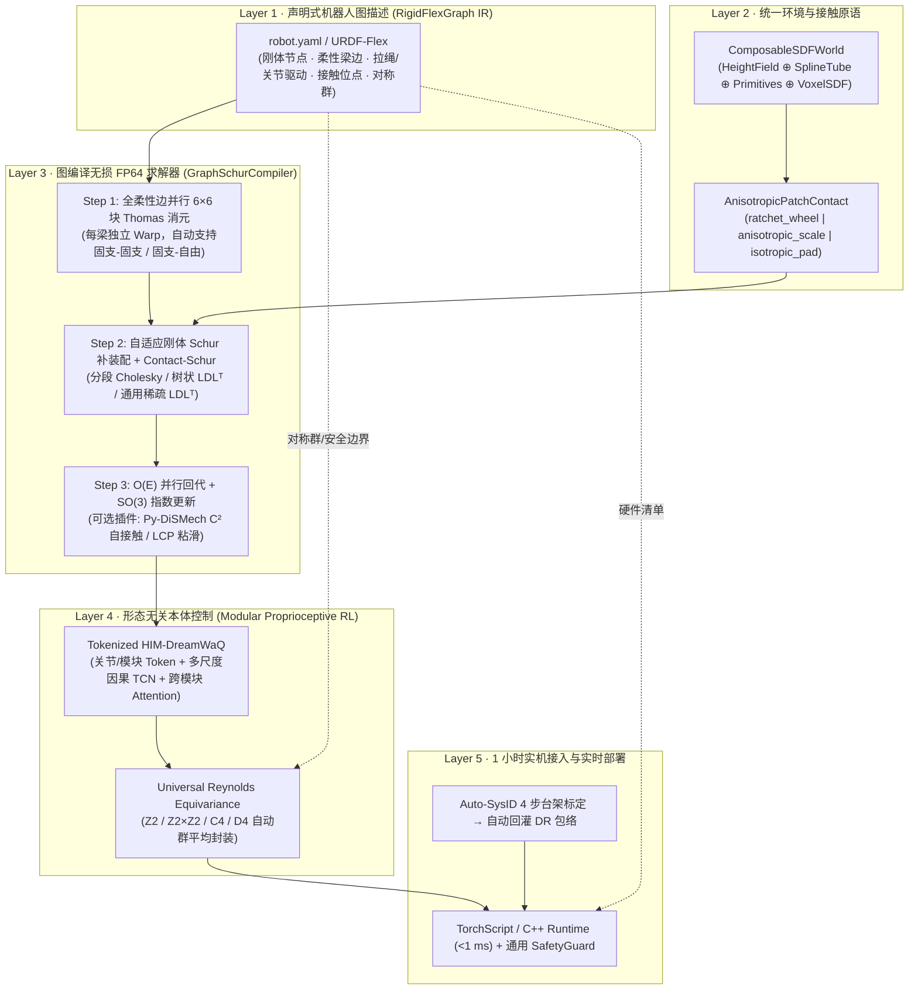

# FlexGraph / ProprioFlex Architecture RFC
## 面向刚柔混联机器人的通用图编译 GPU 仿真、统一接触与形态无关本体控制架构规范

> **定位**：将当前绑定于“5 体节 × 8 钢片 × 14 舵机 × 20 棘轮”的 `SerpWorm-RL` 技术栈，无损抽象为面向**任意刚柔混联与连续体机器人**的统一仿真–标定–控制框架，同时保持与现有 `GPUCore` / `fused_physics.cu` 的严格 FP64 向后等价（`< 1e-10` 误差，零性能回退）。

---

## 1. 核心设计哲学：五层解耦架构

当前系统的四项高壁垒能力（**二分图块 Thomas–Schur 无损求解**、**隐式各向异性接触 ARPC**、**纯软件 `q_err` + HIM-DreamWaQ 本体隐式感知**、**Reynolds 构造级群等变**）在数学上均与特定机械构型无关。通用化的核心是切断“拓扑/构型”与“求解/控制”之间的硬编码耦合：



---

## 2. Layer 1：统一刚柔图中间表示 (`RigidFlexGraph` IR)

任意刚柔混联机器人（并联预弯钢片、连续体机械臂、柔顺脊柱多足、张拉整体、折纸爬虫）均抽象为带属性的多重二分图：

$$
\mathcal{G} = \big(\mathcal{V}_{\mathrm{rigid}},\; \mathcal{E}_{\mathrm{beam}},\; \mathcal{E}_{\mathrm{tendon}},\; \mathcal{E}_{\mathrm{joint}},\; \mathcal{C}_{\mathrm{site}},\; \mathcal{G}_{\mathrm{sym}}\big)
$$

### 2.1 核心数据表 Schema（SoA 扁平数组，直接映射 GPU 显存）

| 组件表 | 索引维度 | 核心物理字段 | 覆盖范围 |
| :--- | :--- | :--- | :--- |
| **`RigidBodySpec`** | `N_b` 刚体 | `mass`, `inertia_3x3`, `rest_pose_7d`, `collision_radius`, `mesh_uri` | 隔板、躯干、刚性连杆、内窥镜分线盘、末端夹爪 |
| **`BeamEdgeSpec`** | `N_s` 柔性梁 | `body_a`, `clamp_a_7d`, `body_b` (`-1` 为自由悬臂), `clamp_b_7d`, `n_elem`, `centerline_pts`, `section(w,t,A,Iy,Iz,J)`, `material(E,nu,rho,alpha_r,beta_r)`, `prestress_frac`, `thin_shell_compat` | 预弯钢片、镍钛合金主干、弹性脊柱、柔顺薄片腿、柔性铰链 |
| **`TendonEdgeSpec`** | `N_t` 拉绳 | `waypoints[(body_k, local_xyz_k), ...]`, `actuator_id`, `drive_mode(crank|capstan|linear)`, `r_horn`, `g_guide`, `slack_m`, `k_ten`, `c_ten`, `capstan_mu_theta`, `stick_slip_enabled` | 曲柄拉绳、多盘穿孔连续体拉线、拮抗肌腱 |
| **`JointEdgeSpec`** | `N_j` 关节 | `body_a`, `body_b`, `joint_type(revolute|prismatic|ball|weld)`, `axis_local`, `limits`, `kp`, `kd`, `tau_max`, `omega_max`, `tau_static_fric`, `deadband`, `bus_delay_ms`, `implicit_coupling` | 偏航舵机、多足髋/膝关节、防撞限位、串联铰链 |
| **`ContactSiteSpec`** | `N_c` 接触位点 | `attach_type(rigid_body|beam_node)`, `owner_id`, `local_pos`, `local_frame`, `radius`, `patch_radius`, `contact_mode(ratchet_wheel|anisotropic_scale|isotropic_pad)`, `mat_profile_id` | 20 颗单向棘轮、600 钢片节点、腹鳞/刚毛阵列、足端脚垫 |
| **`SymmetryGroupSpec`** | `|\mathcal{G}|` 群元 | `group_name`, `obs_perm_sign[g]`, `act_perm_sign[g]`, `est_perm_sign[g]` | $\mathbb{Z}_2$（左右）、$\mathbb{Z}_2\times\mathbb{Z}_2$（左右+前后可逆）、$C_4/D_4$（四向对称） |

### 2.2 极简声明式 YAML 示例：一套引擎写 4 类截然不同的机器人

```yaml
# 示例 A：可变节数 SerpWorm-N（N=3..8 零改代码，N=5 与现版严格 FP64 等价）
robot:
  name: serpworm_N5
  symmetry_group: Z2_bilateral
  template: modular_chain
  n_segments: 5
  segment_module:
    bodies: [plate_front_pcb, plate_back_cf]
    beams:
      - repeat: 8
        profile: parabolic_ribbon
        width_m: 0.016
        thickness_m: 0.00022
        bow_m: 0.030
        n_elem: 16
        material: 65Mn_steel
    tendons:
      - {side: left,  drive: eccentric_crank, r: 0.025, g: 0.036, slack: 0.0114, capstan_mu_theta: 0.18}
      - {side: right, drive: eccentric_crank, r: 0.025, g: 0.036, slack: 0.0114, capstan_mu_theta: 0.18}
    contacts:
      - {on: plates, count: 4, mode: ratchet_wheel, wheel_mass: 0.0179, radius: 0.018, backlash_deg: 10.0}
      - {on: beam_interior_nodes, mode: isotropic_pad, radius: 0.002, sdf_only: true}
  inter_segment_joint: {type: revolute_z, kp: 12.0, tau_max: 2.45, tau_sf: 0.06}
```

```yaml
# 示例 B：无轮刚毛蠕虫/仿生蛇（仅替换接触模式，无需改一行求解器代码）
robot:
  name: bristle_worm_N6
  symmetry_group: Z2xZ2_bidirectional
  # 复用柔性节拓扑，接触层直接切换为腹鳞/刚毛各向异性摩擦
  contacts:
    - {on: plates, count: 4, mode: anisotropic_scale, mu_fwd: 0.12, mu_rev: 0.85, mu_lat: 0.90, patch_r: 0.015}
```

```yaml
# 示例 C：3D 四拉绳连续体导管/机械臂（单中心镍钛杆 + 多分线盘 + 4 拉绳 + 悬臂自由端）
robot:
  name: tendon_endoscope_3d
  symmetry_group: D4_radial
  bodies: [base_fixed, disc_1, disc_2, disc_3, tip_end_effector]
  beams:
    - {body_a: base_fixed, body_b: disc_1, profile: straight_rod, radius_m: 0.0012, material: nitinol, n_elem: 8}
    - {body_a: disc_1,     body_b: disc_2, profile: straight_rod, radius_m: 0.0012, material: nitinol, n_elem: 8}
    - {body_a: disc_2,     body_b: disc_3, profile: straight_rod, radius_m: 0.0012, material: nitinol, n_elem: 8}
    - {body_a: disc_3,     body_b: tip_end_effector, profile: straight_rod, radius_m: 0.0012, material: nitinol, n_elem: 8}
  tendons:
    - {name: t_pos_y, waypoints: [base_fixed, disc_1, disc_2, disc_3, tip_end_effector], offset: [0, +0.006, 0], drive: capstan}
    - {name: t_neg_y, waypoints: [base_fixed, disc_1, disc_2, disc_3, tip_end_effector], offset: [0, -0.006, 0], drive: capstan}
    - {name: t_pos_z, waypoints: [base_fixed, disc_1, disc_2, disc_3, tip_end_effector], offset: [0, 0, +0.006], drive: capstan}
    - {name: t_neg_z, waypoints: [base_fixed, disc_1, disc_2, disc_3, tip_end_effector], offset: [0, 0, -0.006], drive: capstan}
```

```yaml
# 示例 D：柔性钢片脊柱多足/蜈蚣机器人（刚体节段 + 柔性梁脊柱 + 刚性摆动腿）
robot:
  name: flexspine_centipede
  symmetry_group: Z2_bilateral
  # 脊柱由 2 条并联预弯钢片连接相邻躯干，每节左右挂 2 条 2-DoF 刚性腿 + isotropic_pad 脚垫
```

---

## 3. Layer 3：图编译无损 FP64 求解器 (`GraphSchurCompiler`)

### 3.1 通用二分箭头矩阵（Why Bipartite Always Holds）

将全部速度未知量重排为刚体节点 $\mathbf{v}_R \in \mathbb{R}^{6N_b}$ 与柔性链内节点 $\mathbf{v}_F \in \mathbb{R}^{6N_{\mathrm{int}}}$，隐式欧拉/Newmark 系统恒具严格箭头块稀疏结构：

$$
\begin{bmatrix}
\mathbf{H}_{RR} & \mathbf{H}_{RF} \\
\mathbf{H}_{FR} & \mathbf{H}_{FF}
\end{bmatrix}
\begin{bmatrix} \mathbf{v}_R \\ \mathbf{v}_F \end{bmatrix}
=
\begin{bmatrix} \mathbf{b}_R \\ \mathbf{b}_F \end{bmatrix},
\qquad
\mathbf{H}_{FF} = \operatorname{blkdiag}\!\big(\mathbf{T}_1, \mathbf{T}_2, \dots, \mathbf{T}_{N_s}\big)
$$

其中每块 $\mathbf{T}_s$ 为仅沿第 $s$ 根梁分布的 $6\times 6$ 块三对角矩阵（即使计入节点级管壁/地面接触切线刚度 $\mathbf{K}_{\mathrm{con},i}$ 与 `Py-DiSMech` $C^2$ 自接触对角项，依然保持严格块三对角！）。

### 3.2 编译期自动拓扑分析与三步执行流

在机器人图加载时（离线 1 次，耗时 `< 10 ms`），`GraphSchurCompiler` 自动分析刚体耦合邻接图 $\mathcal{G}_R$ 并生成最优 CUDA 执行计划：

1. **Stage 1 — 柔性边完全并行消元（拓扑无关统一 Kernel）**
   - 每条梁 $s \in \{1,\dots,N_s\}$ 分配 1 个 CUDA Warp/Thread-group，在寄存器/共享内存完成 $O(E_s)$ 块 Thomas 前向消元，消去全部内部节点，输出凝聚到两端刚体 $(a_s, b_s)$ 的：
     - 接口 Schur 贡献矩阵 $\mathbf{S}_s = \begin{bmatrix}\mathbf{S}_{aa} & \mathbf{S}_{ab} \\ \mathbf{S}_{ba} & \mathbf{S}_{bb}\end{bmatrix} \in \mathbb{R}^{12\times 12}$（若悬臂端 $b_s = -1$ 则仅输出 $\mathbf{S}_{aa} \in \mathbb{R}^{6\times 6}$）；
     - 接口等效右端 $\mathbf{r}_s = [\mathbf{r}_a;\, \mathbf{r}_b] \in \mathbb{R}^{12}$。
2. **Stage 2 — 自适应刚体 Schur 求解（按 $\mathcal{G}_R$ 自动路由）**
   - 装配 $\mathbf{H}_{RR}^{\mathrm{eff}} = \mathbf{H}_{RR} + \sum_{s}\mathbf{S}_s + \sum_{c}\mathbf{K}_{\mathrm{ARPC},c} + \sum_{j}\mathbf{K}_{\mathrm{joint},j}$。
   - 编译器根据 $\mathcal{G}_R$ 连通分量结构自动选择最快精确求解路径：
     | 刚体图结构 $\mathcal{G}_R$ | 典型机器人 | 自动路由求解核 | 复杂度 |
     | :--- | :--- | :--- | :--- |
     | **独立对子块（连通分量 $n_c=2$）** | SerpWorm（显式偏航耦合） | 并行 $12\times 12$ 寄存器 Cholesky（与现版 bit-exact） | $O(N_{\mathrm{seg}})$ |
     | **串联链 / 树形图（无环）** | 3D 连续体导管、串联蛇、柔顺脊柱多足 | 后序遍历块消元（Block-Tree $LDL^\top$） | $O(N_b)$ |
     | **一般带环小图（$N_b \le 32$）** | 张拉整体、并联柔顺平台、折纸闭环 | 预编译静态稀疏模式 Sparse Block-$LDL^\top$ | $O(\text{nnz}(L))$ |
3. **Stage 3 — 柔性内节点 $O(E)$ 并行回代 + $\mathrm{SO}(3)$ 指数更新**
   - 各梁并行读取两端新刚体速度 $(\mathbf{v}_{a_s}, \mathbf{v}_{b_s})$ 回代内节点速度 $\mathbf{v}_F$，以四元数指数映射 `exp(0.5 h ω)` 保正交更新所有刚体与柔性节点位姿。

### 3.3 进阶物理插件接口（保持零破坏接入）
- **自接触插件（`Py-DiSMech` $C^2$ 软势能）**：统一哈希网格宽相检索近邻节点对 $(i,j)$，分段 $C^2$ 接触势能的半正定 Hessian 块对角部分直接累加至 $\mathbf{T}_s$ 对角块（零线搜索，维持 1 ms 步长与 CUDA Graph 静态捕获）。
- **粘滑记忆插件（`LCP / Stiction Memory`）**：每个接触位点/导孔维护二维切向弹性变形记忆 $\mathbf{m}_t \in \mathbb{R}^2$，在摩擦锥 $\|\mathbf{f}_t\| \le \mu F_n$ 内隐式耦合切线刚度，突破阈值时投影回锥面并更新 $\mathbf{m}_t$，自然复现粘滞–突跳滞回。

---

## 4. Layer 2：统一接触基元与可组合 SDF 世界

### 4.1 统一接触基元 `AnisotropicPatchContact`

将轮地接触、腹鳞/刚毛接触、足垫接触与管壁接触统一为同一纯函数（FP64，无分支发散）：

```python
(wrench_6d, K_tan_6x6, C_tan_6x6, next_state) = eval_arpc_contact(
    pos_w, vel_6d, frame_3x3,      # 接触位点世界位姿与速度
    phi, n_w, mat_props,           # 来自 ComposableSDFWorld 的距离/法向/材质
    patch_cfg,                     # 接触模式与几何参数
    state=(rut, mem_2d, psi, spin) # 隐式接触历史状态
)
```

| `contact_mode` | 启用的内部机制 | 典型机器人 |
| :--- | :--- | :--- |
| **`ratchet_wheel`** | Hunt–Crossley + Bekker 车辙 + 轮自旋惯量 $I_w$ + 棘爪空程 $\psi_{\max}$ + 滚阻 $\mu_{rr}$ + Stribeck 椭圆 + 枢转 $\tau_z$ | SerpWorm 轮式蛇蠕 |
| **`anisotropic_scale`** | Hunt–Crossley + Bekker 车辙 + 非对称方向摩擦 $(\mu_{\mathrm{fwd}} \ll \mu_{\mathrm{rev}}, \mu_{\mathrm{lat}})$ + 切向粘滑记忆 + 枢转 $\tau_z$ | 无轮仿生蛇、刚毛蠕虫、尺蠖 |
| **`isotropic_pad`** | Hunt–Crossley + 弹性/软土车辙 + 各向同性库仑粘滑 + 圆面片枢转 $\tau_z$ | 钢片/导管碰壁节点、足式脚垫、软体吸盘 |

### 4.2 统一环境场 `ComposableSDFWorld`

替代现有 `pipe_cfg[B, 12]` 与分离的地面高度函数，所有环境统一暴露单一查询接口：

$$
\mathrm{query\_sdf}(\mathbf{x}) \;\longmapsto\; \big(\phi(\mathbf{x}),\; \mathbf{n}(\mathbf{x}),\; s_{\mathrm{arc}}(\mathbf{x}),\; \mathbf{t}_{\mathrm{arc}}(\mathbf{x}),\; \mathrm{mat\_id}\big)
$$

通过 4 类底层原语的布尔与光滑并（$\mathrm{smin}_k$）组合构成任意复杂场景，且**物理求解器、RL 进度奖励与 MuJoCo 3D 渲染器共享同一几何真值**：
1. **`HeightField`**：平地、斜坡、微波起伏、石子离散凸包、草地粘滞层、分区 Bekker 软土；
2. **`SplineTube(P_ctrl, r(s), cross_section)`**：单条 3D 三次 B 样条 + 沿弧长变径 $r(s)$ + 截面形状（圆/圆角方/椭圆），统一 subsumes 全部 8 类平面管道、3D 立体螺旋爬升管、变径锥与多分支血管；
3. **`ObstaclePrimitives`**：墙体、窄缝、台阶、柱阵、倒塌废墟；
4. **`VoxelSDF`**：任意工业 CAD 管道或医学 CT 腔道离线烘焙为 3D 纹理 SDF，GPU 硬件三线性插值纳秒级查询。

---

## 5. Layer 4：形态无关本体控制与通用有限群等变

### 5.1 实体 Token 化 `HIM-DreamWaQ`（告别固定 65D/14D）

不再把所有关节拼成一条固定长度扁平向量，而是将机器人的感知–动作拆成**变长实体 Token 集合**：

- **每个执行器/模块 Token $\mathbf{x}_{i,t} \in \mathbb{R}^{d_{\mathrm{in}}}$**：
  `[相对拓扑坐标 pos_norm, 类型嵌入 type_emb(tendon|yaw|leg), q_i, dq_i, q_err_i, u_{i,t-1}, 局部形态属性(可选)]`
- **全局体 Token $\mathbf{x}_{\mathrm{glob},t}$**：
  `[IMU 陀螺仪 ω_b, 重力投影 g_b, 目标速度/急停指令 cmd]`
- **网络数据流**：
  1. **共享实体时序编码器**：对每个 Token 的 $H=16$ 帧历史独立通过共享多尺度右对齐因果 1D-TCN，提取局部时序动力学特征（捕获该执行器处是否撞壁/高阻/失效）；
  2. **轻量跨模块 Self-Attention（带相对拓扑位置偏置）**：在 $N$ 个模块间传递行波相位与局部受阻信号（2 层，单帧 CPU `< 1.5 ms`）；
  3. **瓶颈上下文 `CENet β-VAE + HIM 对比头`**：全局池化出显式状态 $\hat{\mathbf{e}}_t$ + 16D 不确定度门控隐变量 $\tilde{\mathbf{z}}_t = \mathbf{g}_t \odot \mathbf{z}_t$，保留全部前向重构与对比防塌缩约束；
  4. **共享逐执行器动作头**：每个执行器 Token 结合全局上下文 $(\hat{\mathbf{e}}_t, \tilde{\mathbf{z}}_t)$ 输出自身增量动作 $\Delta u_{i,t}$。

**直接解锁的新能力**：
- **跨节数零样本泛化**：`N ∈ {3, 4, 5, 6}` 混训 → 零样本直跑 `N = 7, 8`；
- **执行器/钢片故障在线自愈**：训练中随机将 1–2 个 Token 失能（卡死/断绳），依靠 `q_err_i` 自动识别故障位置并重分配邻近体节推进；
- **跨形态通用本体触觉**：任何位置闭环驱动机器人都自动复用“软件 `q_err` → 隐式外力/阻尼反演”范式。

### 5.2 通用有限对称群 Reynolds 封装

将现有 $\mathbb{Z}_2$ 封装推广为由 `SymmetryGroupSpec` 自动驱动的任意有限群 $\mathcal{G}$ 等变算子：

$$
\bar{\pi}(\mathbf{o}) = \frac{1}{|\mathcal{G}|}\sum_{g \in \mathcal{G}} K_g^{-1}\,\pi\!\big(L_g\,\mathbf{o}\big), \qquad
\bar{\mathbf{e}}(\mathbf{o}) = \frac{1}{|\mathcal{G}|}\sum_{g \in \mathcal{G}} M_g^{-1}\,\hat{\mathbf{e}}\!\big(L_g\,\mathbf{o}\big)
$$

- **$\mathbb{Z}_2$（$|\mathcal{G}|=2$）**：蛇/爬虫/双足左右镜像对称（零直行偏航，左/右弯管一致）；
- **$\mathbb{Z}_2 \times \mathbb{Z}_2$（$|\mathcal{G}|=4$）**：双向可逆蠕虫（左右镜像 + 前后倒置对称，前进/后退完全同效）；
- **$C_4 / D_4$（$|\mathcal{G}|=4, 8$）**：四拉绳 3D 连续体导管或四足机器人（绕轴 $90^\circ$ 旋转 + 反射对称，消除 3D 各向弯曲偏置）。

---

## 6. 对标定位与渐进式落地路线（零破坏现有主线）

### 6.1 与主流软体/连续体仿真-RL 平台的定位对比

| 平台 | 弹性力学模型 | 精度 / 求解 | 单机并行 & 吞吐 | 多构型通用性 | 原生各向异性接触 + 通用本体 RL |
| :--- | :--- | :--- | :--- | :--- | :--- |
| **SOFA / BeamAdapter** | 共旋梁 / 3D FEM | FP64 隐式 | 1–24 核 (`0.1–1.5 sps`) | 高（通用 XML） | 无内置 RL 与隐式 ARPC |
| **MuJoCo / MJX** | 刚体 + 柔体网格 | FP32 / 显式为主 | 高并行 | 高（MJCF） | 薄钢片高刚度比易数值失稳 |
| **PyElastica / DisMech** | Cosserat / DER 杆 | 显式 / 隐式 DER | `~500` 并发 | 中（杆/壳为主） | 缺紧耦合刚体-拉绳-棘轮闭环 |
| **现版 SerpWorm-RL** | 共旋梁 + 块 Thomas–Schur | **FP64 严格无损** | **4,096 并发 / `4,746 sps`** | 单构型（5 节写死） | 强（ARPC + HIM-DreamWaQ + $\mathbb{Z}_2$） |
| **升级版 FlexGraph（本 RFC）** | **任意图编译刚柔混联** | **FP64 严格无损** | **4,096 并发 + 自适应 Schur** | **高（YAML/URDF-Flex）** | **全栈打通（通用 ARPC/SDF + Token 策略 + $\mathcal{G}$ 等变）** |

### 6.2 三阶段零回退工程里程碑

| 阶段 | 交付模块（新建独立包 `src/flexgraph/`，零改动现有 `serpworm/`） | 验收标准（Hard Gate） |
| :--- | :--- | :--- |
| **M1 · 图 IR 与等价性验证** | 实现 `RigidFlexGraph`、`AnisotropicPatchContact`、`ComposableSDFWorld`（PyTorch 参考核）及 `serpworm_to_graph()` 转换器 | 5 节 SerpWorm 经图 IR 运行 200 步，与现版 `GPUCore` FP64 位置/张力/接触力偏差 **`< 1e-10`** |
| **M2 · 四构型物理验证基准** | 编写 4 份 YAML（`SerpWorm-N{3,5,7}`、`BristleWorm`、`TendonEndoscope-3D`、`FlexSpine-Centipede`）+ `SplineTube` 3D 渲染 | 同一求解器零改代码跑通 4 类构型稳定仿真（`dt=1 ms` 零发散），输出统一性能与精度基准 |
| **M3 · 通用 CUDA 编译 + Token 策略** | 通用化 `Block-Thomas + Sparse Schur` CUDA 核；实现 `TokenizedHIMDreamWaQ` + 通用有限群 Reynolds 封装 | ① 5 节 CUDA 吞吐保持现版 `≥ 95%`；② `N=3..6` 混训策略零样本通过 `N=7` 与单舵机断电穿管测试 |
